AI/ML engineer and engineering student in Bengaluru. I design products and build them myself, from the model to the last pixel.

## The studio

## Selected work

  
  
  
  
  
  

each card opens the case study on my site.

## Toolbox

## Lately

## Say hi

  
  
  
  
  
  

bring me the thing that's stuck.

more projects

- **[Canvas Tetris](https://canvas-tetris-brown.vercel.app)**: playable Tetris with ghost pieces, hard drop and a proper game loop. [code](https://github.com/cipherDev64/canvas-tetris)
- **[Code Capsule](https://atulyamanikandan.vercel.app/work/code-capsule)**: a tech blog concept built around reading structure.
- **[Spark](https://atulyamanikandan.vercel.app/work/spark)**: find teammates, show projects, ship together.
- **[F1 Track Visualiser](https://f1-track-visualiser.vercel.app)**: Formula 1 circuits, drawn in the browser. [code](https://github.com/cipherDev64/f1_track_visualiser)
- **[Procrastination Hotline](https://procrastination-hotline.vercel.app)**: a site that roasts you for procrastinating. [code](https://github.com/cipherDev64/procrastination-hotline)
- **[Pallanguzhi](https://pallanguzhi-web-tau.vercel.app)** and **[Navakankari](https://navakankari-web.vercel.app)**: traditional Indian board games, on the web.
- **[FlyRank ML](https://github.com/cipherDev64/flyrankml)**: search ranking and discoverability work from my FlyRank AI internship.

